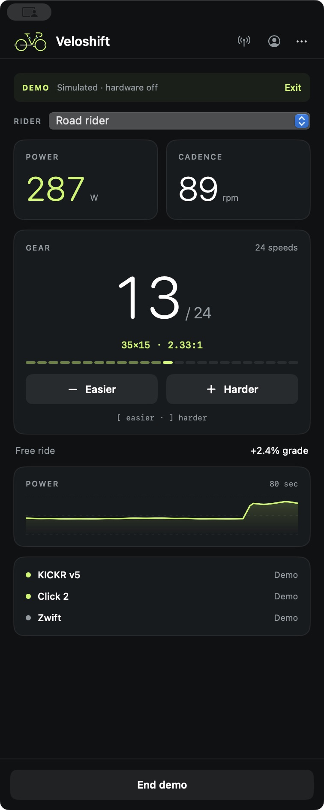

# Veloshift

Virtual shifting for **Wahoo KICKR v5 (2020), Zwift Cog, and Zwift Click 2**, with Zwift and Veloshift running on the **same Mac**.

Veloshift connects to the KICKR and Click controllers over Bluetooth, then presents a virtual trainer to Zwift over the local network. Its narrow companion window fits beside Zwift, with power, cadence, gear, gradient, and connection status in one place.

**Experimental preview:** pairing and resistance control have been confirmed on the original rider’s setup. This is an independent community project, with limited hardware testing. It is not affiliated with Zwift, Wahoo, or SRAM.

<p align="center"></p>

## Download and install

Open the [Releases page](https://github.com/bobloblawdds/Veloshift/releases) and choose **Veloshift 0.6.0 preview**. Download `Veloshift-0.6.0-macOS-arm64.zip` under **Assets**. GitHub’s automatic “Source code” ZIP contains source files, not an installable app. Preview releases may not appear under “Latest.”

Requirements:

- Apple Silicon Mac (M1 or newer), **macOS 14 or later**.
- **KICKR v5 / KICKR 2020** with FTMS-capable firmware.
- Zwift Cog and **Click 2**, the two separate controllers.
- Zwift running on the same Mac, with Bluetooth and Local Network permissions available.

1. Quit any older Velox or Veloshift instance.
2. Unzip the download and move `Veloshift.app` to Applications.
3. Open the app. This preview has a local ad-hoc signature; it is **not Developer ID signed or notarized**. If macOS blocks it as an unidentified developer, review [Apple’s instructions](https://support.apple.com/en-us/102445): after attempting to open it, use **System Settings → Privacy & Security → Open Anyway**, if you trust this download. Do not disable Gatekeeper system-wide.
4. Choose **Ride → Explore demo** to inspect the interface without Bluetooth or network activity.

Only the arm64 download has been built and tested locally. Intel Macs, other trainers, Click 1, Apple TV, and separate-device Zwift setups are outside the tested configuration.

## First ride

1. Update the KICKR v5 firmware with Wahoo, then close Wahoo and other apps that control the trainer.
2. Wake the Click 2 controllers. Some firmware requires first connecting them directly to official Zwift and using them for at least two minutes. Disconnect them from Zwift afterward. See [Click 2 limitations](#click-2-limitations).
3. On Zwift’s pairing screen, unpair the physical KICKR and Click controllers.
4. In Veloshift, open the **antenna icon → Scan devices**. Pedal to wake the KICKR and press the Click buttons. Select and connect the trainer and controllers. Allow Bluetooth access.
5. Confirm the gear changes when you press the controller buttons. The Devices page shows when controller input was last received.
6. Start the bridge in Veloshift. In Zwift, select **Veloshift KICKR v5** with the **network icon** for **Power Source**, **Resistance**, and **Cadence**. Allow Local Network access when requested.
7. Keep Veloshift running while riding. Gear numbers are shown in Veloshift; ERG workouts use Zwift’s power targets and disable shifting.

No physical Direct Connect adapter is required. Veloshift transports FTMS over Direct Connect TCP/Bonjour, rather than advertising a Bluetooth trainer that the same Mac must connect back to.

## Shifting and riders

- Click 2: left **−** makes the gear easier; right **+** makes it harder. A right-controller-only fallback uses **B / +**.
- Keyboard: **[ easier / ] harder**, or **J easier / K harder** in **Riders & gearing → Keyboard shifting**. No modifiers are needed. Each press shifts once. The keys are reserved while the bridge/demo is active and either Zwift’s game or Veloshift’s Ride view has focus; they are also reserved in Zwift chat. Other apps and Veloshift’s settings retain normal typing. Keyboard delivery with Zwift focused still needs broader manual testing.
- Open the **person icon** to add, select, edit, or delete rider profiles. Stop the bridge before changing a rider or their gearing. Each rider saves separate settings. The trash button asks for confirmation; at least one profile must remain.
- **Even effort:** 24 gears with a configurable cruising effort and spacing. Defaults are 150 W in gear 12 at 90 rpm on the reference flat road, with 9 W steps.
- **Match a bike:** enter one/two chainrings and all cassette sprockets for 1×12, 1×13, 2×12, or another supported combination. The included SRAM preset is 48/35 with the 12-speed 10–36 cassette. Ratios are sorted from easiest to hardest, including overlaps; there is no separate front-derailleur control.
- The window initially occupies about 25% of the available display width and full available height. It remembers later adjustments. Use **… → Fit to screen edge** to restore that placement.

See [gearing and resistance](docs/GEARING.md) for load scale, power limits, and model assumptions. Veloshift profiles do not change the account or rider details in Zwift.

## Click 2 limitations

Veloshift decodes public Click 2 button messages but does not implement the proprietary controller unlock. Other bridge projects report a roughly daily left-controller unlock requirement with some firmware. If the left controller stops responding, reconnect it to official Zwift, use it there, then disconnect and reconnect in Veloshift. Alternatively, enable **Right Click only** and use **+ harder / B easier**. Firmware changes may affect compatibility. A Bluetooth “connected” status alone does not prove button traffic works.

## Troubleshooting

| Problem | What to check |
| --- | --- |
| Trainer missing | Pedal to wake it, confirm KICKR 2020/v5 and FTMS-capable firmware, close other controller apps, scan again. |
| Click missing or unresponsive | Press a button, scan again, check Bluetooth permission, and review the unlock limitation above. |
| Trainer missing in Zwift | Start the bridge first; allow Local Network access; select the network trainer. Port 36866 must be free of other bridges such as QZ. |
| Zwift shows the old Velox name | Select the newly named Veloshift trainer on the pairing screen. |
| No resistance | Pair Veloshift as Resistance as well as Power Source; check Activity for FTMS timeouts. Stop and reconnect if telemetry is stale. |
| Keyboard not shifting | Confirm free ride rather than ERG, keyboard shifting enabled, and bridge running with trainer ready. If a hotkey conflict is reported, try the other key pair. |
| Connection lost | Wake devices, scan, reconnect, then explicitly restart the bridge. Automatic reconnect is not implemented. |

Profiles/settings are stored locally in macOS preferences. The app has no account service, analytics, or automatic log upload. **Export diagnostics** creates a local text file only when requested; inspect it for device names or other personal details before posting it in an issue. Trainer telemetry is sent to the connected Zwift network client. The local network trainer transport is not authenticated or encrypted; use it on a trusted network.

## Build and contribute

Uses SwiftUI, CoreBluetooth, Network.framework, and Carbon hotkeys. No external Swift dependencies. Install Xcode Command Line Tools (`xcode-select --install`), then run from the repository root:

```bash
bash scripts/build-app.sh
swift run VeloxChecks
```

The app is built at `dist/Veloshift.app`. `VeloxCore`, `VeloxChecks`, and the `Sources/Velox` directory retain their original internal names for now. Run `bash scripts/package-release.sh` to build, check, sign locally, and create a release ZIP and SHA-256 checksum in `dist/`.

The checks cover protocol packets, actual local TCP discovery/control, controller edge handling, road-load calculations, profile persistence/deletion, and keyboard scoping. All **29 check groups** passed locally in debug and release. Native UI checks covered the companion layout, profile editor, and branded header; they do not replace hardware or Zwift keyboard testing.

See [development notes](docs/DEVELOPMENT.md), [release instructions](docs/RELEASING.md), and [protocol references](docs/REFERENCES.md). Reports should include macOS/app version, exact trainer model/firmware, and Click firmware when known. Never include account credentials or unreviewed personal logs.

## Limits

Veloshift approximates gear-dependent road load using ordinary KICKR power commands. It does not reproduce full drivetrain inertia or Zwift’s native virtual-gearing HUD. Commands are capped at **1,000 W**; high gears can become indistinguishable at that cap. Steering, navigation, proprietary unlock forwarding, and automatic reconnection are not implemented.

The app makes a best-effort zero-power request on stale telemetry, disconnection, stopping, and closing. A process crash or Bluetooth failure cannot guarantee that command reaches the hardware. These failure modes need further bench testing.

Zwift, Wahoo, KICKR, Cog, Click, and SRAM are their owners’ trademarks. References to other projects describe protocol research and compatibility; their source code is not bundled in this repository.

## License

No open-source license has been granted at this time. Public access to this repository does not grant a general right to reuse, modify, or redistribute the code.
